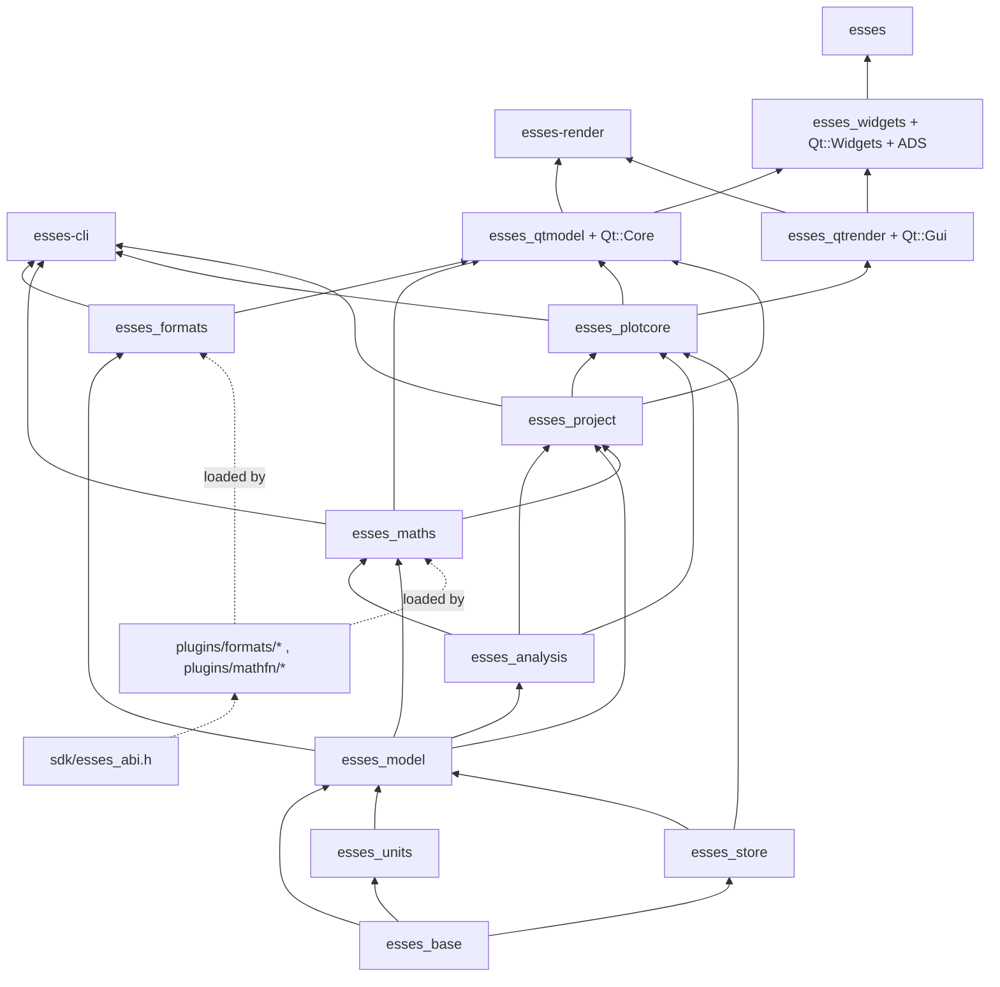

# 01 — Architecture

**Scope.** This document fixes the structure every other document builds on: the layered module map (every `esses_*` target with its responsibility, allowed dependencies, Qt policy and how the policy is enforced), the dependency graph, the data flow from a file on disk to pixels on screen, the threading and ownership model, the `Result`/error conventions, memory budgets, logging and diagnostics (Import Log and the Messages dock), configuration and data directories, and the list of extension points with the version at which each opens. Subsystem internals (store layout, maths kernels, component behaviour, schemas) are specified in documents 02–07 and only summarised here where the structure depends on them. Names of targets, types, interfaces and schema ids are those of `ARCHITECTURE_OUTLINE.md` and are used verbatim; where this document and `DECISIONS.md` differ, `DECISIONS.md` wins and the discrepancy is listed in §12.

**Related decisions.** D-001, D-006, D-007, D-008, D-009, D-011, D-012, D-013, D-015, D-016, D-018, D-019, D-022, D-024, D-025, D-026, D-028, D-029, D-030, D-031, D-032, D-033, D-034, D-035, D-036.

---

## 1. Conventions

| Item | Rule |
|---|---|
| Language | C++20; `/W4 /permissive-` (MSVC), `-Wall -Wextra -Werror` (GCC/Clang) in CI; clang-format and clang-tidy on the Qt-free libraries (D-034) |
| Namespace | `esses`; sub-namespaces per library (`esses::store`, `esses::model`, `esses::formats`, `esses::maths`, `esses::analysis`, `esses::project`, `esses::plot`, `esses::qt`) |
| CMake targets | `esses_<lib>` static libraries; executables `esses` (GUI), `esses-cli` (Qt-free), `esses-render` (Qt Gui, offscreen); C ABI prefix `esses_`; prefix table in `cmake/naming.cmake` (D-003) |
| Time | `using Micros = std::int64_t` microseconds since the data layer origin; `struct Rate { std::uint32_t num, den; }` in Hz; with `D = 1'000'000ull·den`, `timeAt(i) = t0 + floorDiv(2·i·D + num, 2·num)` (= D-008's `llround_div` for `i ≥ 0`) and `indexAt(t) = floorDiv(num·(2(t − t0) + 1) − 1, 2·D)`, the exact inverse of `timeAt` (largest `i` with `timeAt(i) ≤ t`); every product is formed in 128 bits and every division floors toward −∞; `Rate` orders by value (`{2,2} == {1,1}`) (02 §1; D-008 as amended by D-129) |
| Strings | UTF-8 `std::string`/`std::string_view` in layers 0–3; `QString` only in layers 4–5 (D-007) |
| JSON | nlohmann-json behind `JsonDoc`; every persisted document carries `$schema` and `schemaVersion`; schema ids `<name>-<version>` (`sidecar-1`, `project-1`, `workbook-1`, `maths-1`, `probe-1`, …) (D-019) |
| Identity | `SourceId` = the quick content hash, an xxh3-128 `Hash128` over the file size, the first and last MiB and the format header (mtime excluded, so a copied or moved log keeps its id), used for source identity, sidecar match and cache keys; the full-content xxh3-128 is computed at `Background` after first paint and stored in provenance and the sidecar's `source.contentHash` (05 §1.1, 02 §4.1, §5; D-130); `Uuid` for user-created objects; deterministic UUIDv5-style ids for logged objects (D-013, D-014) |
| Layer name | Canonical data-layer name `"Normal"`; `""` accepted on import (D-015) |
| Components | Named by their JSON `type` string (`time_distance`, `outing`, …) (D-027) |
| Milestones | M0 Foundations · M1 Walking skeleton · M2 Channels, maths, persistence · M3 The 80 % components · M4 Hardening and 0.1 · M5 v1.0 · M6 Formats and SDK · M7 v1.1 (D-035) |

---

## 2. Layered module map

### 2.1 Targets

Layer numbers are the outline's. "Qt" states which Qt modules the target may link; "free" means none. "Opens" is the milestone in which the target first exists with tests.

| Layer | Target | Kind | Responsibility | Allowed dependencies | Qt | Opens |
|---|---|---|---|---|---|---|
| 0 | `esses_base` | static lib | `Result<T,Error>`, `Error`, `ErrorCode`, `TextSpan`; `Micros`, `Rate`, `Uuid`, `Hash128` (xxh3); UTF-8 and NFKC case-fold helpers; `Priority`, `CancelToken`, `CancelSource`, `Future<T>`, `TaskPool` (priority pool), `Executor` (abstract submit for inline test execution), `ThreadRole` (`thread_local` no-block flag, §5.3 rule 4); `MappedFile` (read-only view opened with `FILE_SHARE_READ \| FILE_SHARE_DELETE`, never `FILE_SHARE_WRITE`; `stampAtOpen()`/`changedOnDisk()` change detection; `guarded()` decode that turns a page fault into `fail(Io)`; 02 §1 behaviour 5); `ByteReader` (LE/BE); `ILogSink`, `LogRecord`, `Log`; `JsonDoc`; `Paths` (§9) | STL, nlohmann-json, xxhash; on Windows `shell32`/`ole32` (known-folder lookup, §9) | free | M0 |
| 0 | `esses_units` | static lib | `UnitRegistry`, `Quantity`, `Unit`, `Dimension`, `Converter`; loads `data/units.json` (own table with dimension vectors and display families plus i2 symbol aliases) | base | free | M0 |
| 1 | `esses_store` | static lib | `Chunk`, `Validity`, `MinMaxPyramid`, `SummaryPyramid`, `ChunkCache`, `ChunkHandle`, `IChunkProvider`, `Column`, `UniformSeries`, `TimestampedSeries`, `Series`, `Resampler`, `Interp`, `ResampleView` | base | free | M0 |
| 1 | `esses_model` | static lib | `DataSource`, `DataLayer`, `Channel`, `ChannelDescriptor`, `ChannelId`, `Marker`, `MarkerEdit`, `Range`, `RangeGroup`, `RangeRef`, `Detail`, `EnumTable`, `SidecarDocument`, `ChannelResolver` (constructed from the Qt-free PODs `MappingTable` and `AliasTable`, 02 §4.6), `ResolutionTrace` | base, units, store | free | M0 |
| 2 | `esses_formats` | static lib | `IImporter`, `IReader`, `IWriter`, `ImporterRegistry`, `SniffResult`, `ProbeResult` (↔ `probe_json`), `ImportOptions`, `ImportLog`, `ImportLogEntry`, `ByteSource` (contracts owned by 05 §1.1–1.3); readers `motec.ld` (+`.ldx` companion), `motec.csv`, `text.profile:*` via `TextEngine` + `TextProfile`; writers `.ld`+`.ldx`, MoTeC CSV, generic CSV; `Dictionary`, `UnitMappingProfile`; `LdChunkProvider`, `ImporterChunkProvider`; C-ABI host and adapters (v1.0) | base, units, store, model, pugixml, zlib, fast_float | free | M0 |
| 2 | `esses_analysis` | static lib | `IRangeRule`, `BeaconPairRule`, `WholeOutingRule`, `TrackSectionsRule`, `RuleRunner`; `DistanceIndex`, `LapStretch`; `CorrectedSpeed`, `CorrectedDistance`, `GpsCorrections`, `DamperVelocity` algorithms; `TrackMap`, `TrackGenerator`, `SectionDetector`; `VarianceTable`; `ReportEngine`, `TimeReportEngine`, `ReportSpec`, `StatCache`; `HistogramBinner`, `ScatterBinner`, `TrendFit`, `Spectrum` (pocketfft) | base, units, store, model, Eigen, pocketfft | free | M1 |
| 2 | `esses_maths` | static lib | `Lexer`, `Parser`, `Ast`, `TypeChecker`, `Diagnostic`, `Plan`, `Kernel` classes, `BlockCtx`, `PlanProvider`, `MathInputGatherer` (per-input wrapper over `esses_store`'s `ResampleView`, 03 §6.3), `MathGraph`, `MathsScheduler`, `MathModule`, `MathItem`, `EvalContext`, `IMathFunction`, built-in modules (`esses.corrected_speed_distance`, `esses.gps_corrections`, `esses.damper_velocity`), `MathsCompat`; C-ABI function host (v1.0) | base, units, store, model, analysis, Iir1 | free | M1 (minimal), M2 (full) |
| 2 | `esses_project` | static lib | Qt-free documents and schemas: `ProjectFile`, `WorkbookFile`, `WorksheetDef`, `ComponentSpec`, `ChannelOverrides`, `Aliases`, `Mappings`, `Scheme`, `Keymap`, `Profile`, `TrackMapFile`, `SchemaRegistry`, `Migrations`, `Journal`, `Archive` (v1.0); validates `maths-1` documents against `SchemaRegistry` and loads them into `esses_maths::MathModule` through `esses_maths::MathModuleIo` (`MathsService` receives the loaded modules, 03 §1); hosts **all** v1.0 i2 configuration-file importers (`.i2wkb`/`.i2wsp` → `workbook-1`, `.mcs/.mfs` → `scheme-1`, maths XML → `maths-1`) under `libs/project/src/cfgimport/` with neutral class names (`Cfg*Importer`, 00 §8) | base, units, model, analysis, maths, json-schema-validator; pugixml (private, v1.0 importers) | free | M1 |
| 3 | `esses_plotcore` | static lib | `ViewState`, `ChangeMask`, `SelectionSnapshot`, `DomainMapper`, `DistanceChain`, `AutoscaleCache`, `TraceBuilder`, `M4Column`, `AxisLayout`, `BandLayout`, `KeyLayout`, `HitTester`, `DrawList`, `DrawCmd`, `TextRun`, `LayerKind`, `IRenderBackend`, `ITextMetrics`, `Bitmap`, `ScatterGeometry`, `HistogramGeometry`, `TrackGeometry`, `OutingGeometry` (declarations owned by 04 §2 and §5) | base, store, model, analysis, project (and so, transitively, maths) | free | M1 |
| 3 | `esses_cli` | executable `esses-cli` | `info`, `channels`, `laps`, `eval`, `convert`, `export`, `validate`, `fixture add\|verify\|diff`, `bench`; every command has `--json` | all Qt-free libs, CLI11 | free | M0 |
| 3 | `esses_capi` | static/shared | Stable `extern "C"` surface over formats + model + maths for bindings | all Qt-free libs | free | v1.1 |
| 3 | `esses_script` | static lib | Lua 5.4 + sol2 sandbox, object model, scripted `IMathFunction`/`IRangeRule`/`IImporter` | all Qt-free libs, lua, sol2 | free | v1.1 |
| 4 | `esses_qtmodel` | static lib | `DataSelectionModel`, `WorkspaceViewModel` (workspace-shared zoom, cursor and datum, D-133), `WorksheetViewModel`, `RenderService` (keyed replace-key build submission over `TaskPool` with `Dispatcher` delivery, 04 §6.3), `ProjectSession` (+ `QUndoStack` commands), `SourceLoader`, `MathsService`, `Dispatcher`, `AppRuntime` (owns pool, cache, dispatcher and sinks; §5.3 rule 11), `CommandRegistry`, `KeymapBinder`, `SettingsStore`, `MessagesModel` | all Qt-free libs, Qt::Core | Core | M1 |
| 4 | `esses_qtrender` | static lib | `RasterBackend : IRenderBackend` (QPainter → `QImage` layers), `LayerCache` (one cached Static `QImage`; Dynamic and Chrome `DrawList`s painted directly, 04 §6.2, D-137), `OffscreenRenderer`, `SchemeFonts`, `QtTextMetrics` (thread-safe `ITextMetrics`, 04 §5.4); later `GlBackend`, `RhiBackend` | plotcore, Qt::Gui (later Qt::OpenGL) | Gui | M1 |
| 4 | `esses_render` | executable `esses-render` | `esses-render <workbook.json> <log…> --worksheet N -o out.png [--dpr 2]` | qtmodel, qtrender | Gui (offscreen) | M1 |
| 5 | `esses_widgets` | static lib | `DockHost` (ADS facade), `WorksheetCanvas`, `ComponentWidget` and every component, docks, dialogs and editors, `PropertiesDialog`, `MappingPanel`, `ZoomSummaryBar` | qtmodel, qtrender, Qt::Widgets, ADS | Widgets | M1 |
| 5 | `esses_app` | executable `esses` | `MainWindow`, menus and toolbars, keymap binding, session restore, file associations, `-w <project> -l <log>` | widgets | Widgets | M1 |
| 5 | `esses_video` | static lib | `IVideoPlayer` over Qt Multimedia, PTS/log-time offset model | qtmodel, Qt::Multimedia | Multimedia | v1.1 |
| — | `plugins/formats/*`, `plugins/mathfn/*` | shared libs | C-ABI plugins; may privately link any non-Qt library; Qt only under the 05 §10.3 `qt` modes (`none \| static \| infix \| dynamic`, `dynamic` only with `minVersion` ≤ the host's Qt), never creating a `QCoreApplication`; a plugin that returns `ESSES_E_INTERNAL` is disabled, never unloaded; descriptor strings are plugin-static and only out-parameter strings use `host->alloc` (D-131) | `sdk/esses_abi.h` only | n/a | v1.0 |

Third-party libraries by target (all vendored under `third_party/` and built in the tree, D-147; Qt and ADS excepted): nlohmann-json, xxhash (base); pugixml, zlib, fast_float (formats); eigen3, pocketfft (vendored header-only, BSD-3) (analysis); Iir1 (vendored, MIT, built as a static library from its sources) (maths); json-schema-validator (vendored, MIT, built as a static library) and pugixml (v1.0 importers) (project); CLI11 (cli); Qt Advanced Docking System as a shared library via FetchContent with a pinned tag (widgets, D-119); lua, sol2 (script, v1.1); sqlite3 amalgamation (project, v1.0, indexed Open dialog only); catch2, benchmark (tests). Never: QtSql, QtConcurrent, QThreadPool, fast-cpp-csv-parser, KDDockWidgets, QCustomPlot, FFTW, vector_blf, any GPL-only Qt module (D-006, D-019, D-029, D-031).

### 2.2 Dependency rules

1. **Downward only.** A target links only targets in lower layers (or the same layer where the table says so: `maths → analysis`, `project → analysis`, `project → maths`). `esses_formats` never depends on `esses_maths`, `esses_analysis` or `esses_project`; `esses_analysis` never depends on `esses_maths`; `esses_maths` never depends on `esses_project` or `esses_formats`; `esses_qtrender` never depends on `esses_qtmodel`. `esses_model` has no upward dependency: `ChannelResolver` takes the model-owned PODs `MappingTable`/`AliasTable` (02 §4.6), and `esses_project` converts its `Mappings`/`Aliases` documents to them on load and on every edit.
2. **No upward calls.** Layer 4 observes layer ≤ 3 objects by polling versions or through `Dispatcher`-posted completions; no object in layers 0–3 holds a callback that can fire into a `QObject`. Layer-3 objects expose `version()` counters and `Future<T>`s; they never expose signals.
3. **Qt-free line.** Layers 0–3 contain no `#include <Q…>` and link no `Qt6::` target. `ESSES_BUILD_QT=OFF` configures and builds them plus `esses-cli` and their tests with no Qt installed, on all three operating systems (D-007).
4. **Qt Core** is allowed only in `esses_qtmodel`; **Qt Gui** only in `esses_qtrender` and `esses_render`; **Qt Widgets** and ADS only in `esses_widgets` and `esses_app`. Text is rasterised only in `esses_qtrender`; `esses_plotcore` emits text *runs* (UTF-8, style id, anchor), not glyphs.
5. **Plugins are outside the rule.** A `plugins/formats/*` library may link QtCore only under the 05 §10.3 `qt` modes; it may include only `sdk/esses_abi.h` from the project (D-028, D-131).
6. **Persisted documents** are JSON with `$schema` + `schemaVersion`, validated by `SchemaRegistry` on load and by `esses-cli validate` (D-019).

### 2.3 Enforcement

| Mechanism | What it catches | Where |
|---|---|---|
| `target_link_libraries(... PRIVATE/PUBLIC ...)` scoping; every library lists its dependencies explicitly; no `include_directories()` at top level | A target including a header from a layer it does not link fails to compile | each `libs/<lib>/CMakeLists.txt` |
| `cmake/qt-free-check.cmake` (08 §3.9 is the implementation; no second sketch is kept here) | A Qt include (`<Q…>`, `<Qt…>`, `<QtCore>`, lower-case `<q….h>`) or a Qt type token (`QString`, `QObject`, `QByteArray`, …) in the sources or headers of a Qt-free target; any `Qt6::`/ADS target in the transitive link closure of a Qt-free target; fails at configure time | every target in `ESSES_QT_FREE_TARGETS` (base, units, store, model, formats, analysis, maths, project, plotcore, cli, capi, script) |
| `ESSES_BUILD_QT=OFF` CI job (`core`) on ubuntu, windows, macos with no Qt on the runner | A hidden Qt dependency, a Qt type in a public header, a test that needs a display | `.github/workflows/ci.yml`, ~4 min |
| Layer check inside `esses_add_library()` (08 §3.4): each target declares `LAYER n`; a `DEPS`/`PRIVATE_DEPS` entry that is an `esses::` target with a higher `ESSES_LAYER` fails configure | Upward links | every library target |
| `tools/check_layering.py` over `compile_commands.json` and include lines (08 §2, §5) | An `#include <esses/<other>/…>` for a library not in the target's declared `DEPS`; the forbidden pairs of §2.2 rule 1 | `lint` job |
| Vendor-mark lint (D-003, 00 §8, 08 §5) | `motec`/`i2` outside the allow-list, including identifier tokens such as `I2…` and `Mtc…` | `lint` job |
| TSan on `esses_base`, `esses_store`, `esses_maths` and `esses_plotcore` tests | Data races in the pool, the chunk cache and the two libraries that run most on workers | `sanitize` job |

---

## 3. Dependency graph

### 3.1 Mermaid



### 3.2 ASCII (layers top-down; an arrow means "depends on")

```
Layer 5  esses_app ──► esses_widgets ──► { esses_qtmodel, esses_qtrender }        [Qt Widgets + ADS]
Layer 4  esses-render ──► { esses_qtmodel, esses_qtrender }                      [Qt Gui offscreen]
         esses_qtmodel ──► { formats, maths, analysis, project, plotcore, … }    [Qt Core]
         esses_qtrender ──► plotcore                                             [Qt Gui]
─────────────────────────────── Qt-free line (cmake/qt-free-check.cmake) ───────────────────────────────
Layer 3  esses-cli ──► every Qt-free lib            esses_capi / esses_script (v1.1) ──► every Qt-free lib
         esses_plotcore ──► { base, store, model, analysis, project }
Layer 2  esses_maths ──► { base, units, store, model, analysis }
         esses_project ──► { base, units, model, analysis, maths }   (same-layer edge; maths never links project)
         esses_formats ──► { base, units, store, model }        esses_analysis ──► { base, units, store, model }
Layer 1  esses_model ──► { base, units, store }                 esses_store ──► { base }
Layer 0  esses_units ──► { base }                               esses_base ──► { STL, nlohmann-json, xxhash }
Plugins  plugins/formats/*, plugins/mathfn/* ──► sdk/esses_abi.h only (loaded at run time by formats / maths, v1.0)
```

---

## 4. Data flow: file to pixels

Every step names the thread it runs on, the `TaskPool` priority (D-031) and the snapshot it reads. "GUI" means the Qt GUI thread; "worker" means a `TaskPool` thread.

### 4.1 Open: file → published `DataSource`

| Step | Thread / priority | Reads | Produces | Owner |
|---|---|---|---|---|
| 1. **Sniff** | worker, `Interactive` | first 64 KiB + file size | ranked `SniffResult{confidence 0..100, companions[], reason}` per importer; the user's override is remembered per `(extension, preamble fingerprint)` in `SettingsStore` | `ImporterRegistry::sniff` |
| 2. **Probe** | worker, `Interactive` | header/metadata only (≤ 200 ms on a 500 MB file, fixture-tested) | `ProbeResult` (details, layers, channel descriptors with rate/kind/count/vendor unit string, markers as found, enum tables, `ImportLog`) ↔ `probe_json` (`probe-1`) | `IImporter::probe` |
| 3. **Open** | worker, `Interactive` | header | `IReader`; `DataSource` skeleton with `id = SourceId` (the quick hash, final before this step, 05 §2 step 1) whose `Channel`s hold `Column`s fed by `LdChunkProvider` (mmap decode per chunk) or `ImporterChunkProvider` (`IReader::readBlock`); nothing beyond the header is read | `IImporter::open`, `SourceLoader` |
| 4. **Resolve** | worker, `Interactive` | in this order (05 §2 step 4): importer `Dictionary`, `UnitMappingProfile`, then project `Mappings` and `Aliases` through `ChannelResolver` | canonical descriptors; a `ResolutionTrace` per lookup; unknown units/names end task A with a `PendingResolution` that the GUI shows in the `MappingPanel`; the GUI submits task B with the decision (no pool task waits for the user) | `ChannelResolver` |
| 5. **Merge edits** | worker, `Interactive` | `<file>.<ext>.sidecar.json`, `.ldx` companion | markers with provenance, details, `MarkerEdit`s applied, `rangeOverrides`, `localMaths`; precedence sidecar > companion > file | `SidecarDocument` |
| 6. **Ranges** | worker, `Interactive` | layer markers, profile rules | `RangeGroup` tree (`Outings`, `Outings:Laps`, `Outings:Laps:Track Sections:<set>`) with trust flags and sidecar overrides | `RuleRunner` over `IRangeRule`s |
| 7. **Built-in maths** | worker, `Background` | the sealed source | `MathGraph` registered (global modules, local maths, `esses.corrected_speed_distance`); `Corr Speed`/`Corr Dist` prefetched. After publish, one `summary/<sourceId>` task builds every logged channel's `SummaryPyramid` through `Column::buildSummary`, which streams chunks through a scratch builder and never inserts them into `ChunkCache` (02 §3.2 rule 10), so the summary pass makes nothing resident | `MathsScheduler`, `Column::buildSummary` |
| 8. **Publish** | GUI (via `Dispatcher::post`) | `std::shared_ptr<const DataSource>` | Data window row; `MessagesModel` receives the `ImportLog`; circuit track map auto-generated if absent and the channels exist | `SourceLoader`, `DataSelectionModel` |

The pipeline runs as two `TaskPool` tasks so that no worker ever waits for user input (§5.1, rule W). **Task A** (`open/<canonical path>/<size>/<mtime>/a`, steps 1–4) ends either with a resolved skeleton, in which case it continues directly into task B on the same worker, or with a `PendingResolution` value (the unresolved rows and the partially built skeleton) that is posted to the GUI. The GUI shows the `MappingPanel`; when the user decides, the GUI submits **task B** (`open/<canonical path>/<size>/<mtime>/b`, steps 5–7) with the `MappingDecision` by value. A headless caller (`esses-cli`) applies `--unitmap`/`--strict-units` inside task A and never produces a `PendingResolution`. A second open of the same file coalesces onto the same `Future` (share-key). Cancellation (closing the dialog, DELETE in the Data window, Cancel in the Mapping panel) is checked between steps and per chunk inside step 7.

The formats contracts (`ByteSource`, `SniffResult`, `ImportLogEntry`/`ImportLog`, `ImportOptions`, `ProbeResult`, `IImporter`, `IReader`, `IWriter`, `ImporterRegistry`) are declared once, in 05 §1.1–1.3 and §2; this document does not repeat them. Two architecture-level constraints apply to them: `IImporter::open` receives the source as `std::shared_ptr<const ByteSource>`, and the returned `IReader` and every `LdChunkProvider`/`ImporterChunkProvider` built from it hold that `shared_ptr`, so a reader never outlives its bytes (§5.3 rule 9); and `ImporterRegistry::load` takes a `MappingHook` that returns a `PendingResolution` rather than blocking, with `ImporterRegistry::resume` running task B (05 §2 step 4, §8.1).

### 4.2 Draw: selection and view → pixels

1. **Selection.** ENTER / CTRL+ENTER / ALT+ENTER in the Data window → `DataSelectionModel` emits a new `SelectionSnapshot` (GUI). `WorksheetViewModel` updates its `ViewState` and emits `changed(ChangeMask(Change::Selection))` (GUI).
2. **Mask → passes.** Each `ComponentWidget` maps the mask to invalidated layers (table in §5.5). A `time_distance` component with a Static invalidation submits one trace-build task keyed `trace/<worksheet>/<component>` at `Visible` priority; a still-queued task with that key is replaced, a running one is left to finish (latest-wins, §5.4 rule 2).
3. **Trace build** (worker, `Visible`; parallel per trace inside the task). For each `(trace, range)`: `DomainMapper` maps the visible `XSpan` to a sample span of the trace's `Column` (time: affine on `Rate` plus the range's `offsetUs`; distance: that lap's `DistanceIndex`, held as `std::shared_ptr<const DistanceIndex>`, plus `offsetM` and `stretch`); `TraceBuilder` pins the chunks with a `ChunkHandle` (`Column::require`, which materialises missing chunks inline on the calling worker and waits only for a chunk that another running thread is already building, §5.1 rule W), computes exact `M4Column`s per device pixel (D-012: raw joined below 2 samples/px, raw-sample M4 below 32, pyramid path above with hierarchical boundary descent), applies the display-unit `Converter` while writing vertices, splits polylines at validity gaps and appends to the Static `DrawList`; `AxisLayout`, `BandLayout` and `KeyLayout` add ticks, range/section/marker bands and text runs; `VarianceTable` adds the variance panel polylines when F3 is on. The task reads only a copied `ViewState`, a copied `SelectionSnapshot`, the `ComponentSpec` by value, `std::shared_ptr<const DataSource>` snapshots, `std::shared_ptr<const DistanceIndex>` and `std::shared_ptr<const ITextMetrics>` (§5.3 rule 9).
4. **Hand-off.** The finished `DrawList` is posted through `Dispatcher::post(component, …)` tagged `(componentId, viewVersion)`; on the GUI the closure runs only if the component still exists, and the component stores the list in its `LayerCache` slot and calls `update()` unless `viewVersion` is stale under 04 §2.1 rule 4.
5. **Paint** (GUI, `paintEvent`). `RasterBackend` renders the Static `DrawList` into the component's Static `QImage` layer at device pixels (DPR applied once); the Dynamic layer (cursor, datum, measurement hover line, key values via `Column::tryPin` into the paint's pin arena and `Resampler::valueAt`, §5.3 rule 5) is rebuilt on `Cursor|Datum` masks only; Chrome on caption/focus changes; `LayerCache::paint` blits the exposed part of the Static image and paints the Dynamic and Chrome `DrawList`s directly under the damage region (04 §6.2, D-137). A Static rebuild in flight does not block: the previous Static image stays until the new one arrives.
6. **Values and labels.** The key column, the Values window and gauges read `Resampler::valueAt(series, cursorT, interp)` for Main and through each overlay's `DomainMapper`; Pending maths rows show "…" and queue evaluation at `Background`.
7. **Summary components.** `scatter`, `histogram` (later `spectrum`, `suspension_histogram`, `mixture_map`) recompute geometry on `Zoom|Selection|Data` masks on a worker (`ScatterBinner`, `HistogramBinner`, `TrendFit`, `HistogramGeometry`, `ScatterGeometry`) and paint on completion.

The plot-core types (`Domain`, `XSpan`, `ViewState`, `Change`/`ChangeMask`, `SelectionSnapshot` with `referenceOverlay() → std::optional<RangeRef>`, `version` and `visibleSlots()`, `LayerKind`, `CmdKind`, `DrawCmd`, `TextRun`, `DrawList`, `LayerHandle`, `Bitmap`, `IRenderBackend` with `beginLayer(kind, widthPx, heightPx, dpr, clear)`, `compose(handles, target)`, `readback`, `release`, `textMetrics()`, and `ITextMetrics`) are declared once, in 04 §2.1–2.3 and §5.1–5.4; this document does not repeat them. The only addition made here is the bit-set operator that 04 §2.2's `ChangeMask` needs to compile when masks are combined:

```cpp
namespace esses::plot {
enum class Change : std::uint16_t { Cursor = 1, Datum = 2, Zoom = 4, Domain = 8, Selection = 16,
                                     Offsets = 32, Data = 64, Scale = 128, Size = 256, Scheme = 512 };
using ChangeMask = std::uint16_t;                                   // OR of Change bits (04 §2.2)
constexpr ChangeMask operator|(Change a, Change b) noexcept { return ChangeMask(ChangeMask(a) | ChangeMask(b)); }
constexpr ChangeMask operator|(ChangeMask m, Change b) noexcept { return ChangeMask(m | ChangeMask(b)); }
constexpr bool has(ChangeMask m, Change b) noexcept { return (m & ChangeMask(b)) != 0; }
}
```

### 4.3 Maths: request → result

`MathsService::require(ChannelKey, SampleRange, Priority)` (GUI facade) → `MathGraph::require` resolves the node under i2's shadowing order (local before global, module order, first definition wins, self-maths shadows consumers), computes the node version `hash(definition hash, enabled, upstream versions, source version)` and the cache key `(ChannelKey, version[, selectionKey])`, hits the `ChunkCache` or schedules a `PlanProvider` materialisation on the `TaskPool`: chunk-independent plans run in parallel per chunk with halos; whole-extent plans (zero-phase IIR, stateful kernels) on one worker. Result chunks are pyramided and cached exactly like logged data. `Dispatcher::post` delivers `ChannelReady(key, version)`; components holding Pending traces resubmit their trace build. Editing an item bumps its definition hash, so only its dependency cone becomes Pending (D-022). The GUI thread never evaluates maths.

### 4.4 Reports

`channel_report` and `time_report` build a `ReportSpec` from their `ComponentSpec` and the current `SelectionSnapshot`; `ReportEngine::cells` runs on workers (`Background`) through `StatCache` keyed `(channelId, version, rangeId, stat)`; Δ-versus-Overlay-0 cells use `VarianceTable`; the `QAbstractTableModel` behind the `QTableView` updates incrementally as cells arrive through `Dispatcher`.

### 4.5 Sequence (cursor move versus zoom)

```
cursor key ──GUI──► WorksheetViewModel::moveCursor ──► changed(Cursor)
                    └► every linked ComponentWidget: Dynamic layer rebuilt in paintEvent (≤ 4 ms budget), no worker involved
zoom key ───GUI──► WorksheetViewModel::zoom ──► changed(Zoom)
                    └► TimeDistanceGraph: TaskPool.submit(Visible, "trace/ws/cmp", build)   (replaces a queued build; a running one finishes)
                          worker: DomainMapper → Column::require (ChunkHandle, inline materialise) → TraceBuilder (M4) → DrawList
                          Dispatcher::post(cmp, …) ──GUI──► version check → LayerCache.store(Static) → update() → paintEvent composes
                          if a newer build is pending, it starts as soon as this one completes (at most one running + one pending per key)
```

---

## 5. Threading and ownership

### 5.1 The pool

One Qt-free `TaskPool` per process in `esses_base` (D-031), owned by the process runtime (§5.3 rule 11). Workers are `std::thread`s that `~TaskPool` stops through an atomic flag and joins: the semantics D-031 asks of `std::jthread` without depending on `std::jthread`/`<stop_token>`, which the Apple libc++ of the Xcode versions on the `macos-14` runner does not provide by default (to be confirmed on the pinned runner image; proposed in DECISIONS.md Addendum A); cancellation uses our own `CancelToken`, never `std::stop_token`. Count = hardware threads − 1, minimum 2. Three priority bands; a strictly higher band is always dequeued first; within a band, FIFO except that trace builds are ordered by distance from the cursor's worksheet (foreground worksheet first). No `QtConcurrent`, no `QThreadPool`, no ad-hoc `std::thread` anywhere else in the tree (clang-tidy bans `std::thread` and `QThread` construction outside `esses_base` and `esses_qtmodel::Dispatcher`).

```cpp
namespace esses {
enum class Priority : std::uint8_t { Interactive = 0, Visible = 1, Background = 2 };

struct TaskKey { std::string text; };             // hierarchical, '/'-separated; see §5.4

class CancelSource;                               // owner side: cancel(), token()
class CancelToken {                               // shared, copyable, cheap
public:
  bool cancelled() const noexcept;
  bool checkpoint() const noexcept;               // same as cancelled(); named for readability at chunk/block boundaries
};

template <class T> class Future {                 // shared-state handle; copyable; results are Result<T>
public:
  bool ready() const noexcept;
  std::optional<Result<T>> tryGet() const;        // non-blocking copy (copyable T only); the only accessor the GUI thread may call
  const Result<T>& get() const;                   // blocking; workers and CLI only (asserted in debug builds);
                                                  // on a worker it first calls TaskPool::tryRunInline(key) (rule W)
  Result<T> take() &&;                            // blocking like get(), then moves the result out; only for the sole holder
                                                  // (asserted), e.g. Future<std::unique_ptr<formats::IReader>>
  void onReady(std::function<void(const Result<T>&)> fn);
      // runs on the completing worker; if the Future is already ready, fn runs inline on the calling thread,
      // which may be the GUI thread. GUI work inside fn still goes through Dispatcher::post(context, …).
};

class TaskPool {
public:
  explicit TaskPool(unsigned workers = defaultWorkerCount());
  ~TaskPool();                                    // stop flag, cancelAll(""), join
  template <class F>
  auto submit(Priority, TaskKey, CancelToken requester, F&& fn) -> Future<std::invoke_result_t<F&, CancelToken>>;
  bool tryRunInline(const TaskKey&);              // still queued → dequeue and run on the calling thread, return true;
                                                  // running, done or unknown → false
  void cancelAll(std::string_view keyPrefix);    // cancels queued and running tasks whose key starts with the prefix
  void raise(const TaskKey&, Priority);           // re-prioritise a queued task (no-op if running or done)
  void join();                                    // refuse new work, cancel, wait for running tasks, join workers (§5.3 rule 11)
  struct Stats { std::size_t queued[3], running, workers; };
  Stats stats() const;
  static TaskPool& instance();                    // the pool installed by the runtime (§5.3 rule 11); asserts if none;
                                                  // tests construct their own
};

class Executor {                                  // abstract submit used by maths/plot so tests can run inline
public:
  virtual ~Executor() = default;
  virtual void run(Priority, TaskKey, CancelToken, std::function<void(CancelToken)>) = 0;
};
}
```

`esses::store` uses this `Priority` through `using Priority = esses::Priority;`; there is no second enum (02 §3.2).

**Pool semantics.**

1. **Type-checked coalescing.** The key table stores `std::shared_ptr<SharedStateBase>` plus the `std::type_index` of the result type. A `submit` whose key matches an entry with a different result type is a bug: `ESSES_ASSERT` in debug builds, and the new `Future` resolves to `fail(ErrorCode::Internal, "task key type mismatch")` in release builds.
2. **Exceptions never escape a worker.** Every task runs inside a trampoline: `try { st->set(fn(tok)); } catch (const std::bad_alloc&) { st->set(fail<T>(ErrorCode::OutOfMemory, "bad_alloc")); } catch (...) { st->set(fail<T>(ErrorCode::Internal, "exception in task")); }`. An exception that escapes a `std::thread` would call `std::terminate`; nlohmann-json and allocation failures are the expected sources.
3. **Share-key cancellation is collective.** A share-key task (§5.4 rule 3) runs under a pool-owned `CancelSource`, not under its first requester's token. Each requester's token is registered with the task; the task is cancelled only when every registered requester has cancelled (a reference count). `chunk/` and `summary/` tasks additionally ignore requester cancellation and are cancelled only by `cancelAll(<source prefix>)` when the source closes.

**Rule W — a pool thread never waits for a task that is not already running.** With a fixed pool (D-031) a worker that blocks on queued work can occupy the very thread that would run it; a few components with per-trace subtasks are enough to park every worker. Four mechanisms implement the rule:

- (a) **`Column::require` materialises inline.** Each chunk slot carries an atomic state `{Absent, Building(owner thread), Sealed}`. `require` walks the span: for an `Absent` chunk it CASes the state to `Building(self)` and materialises the chunk on the calling thread. A chunk-independent provider may first submit the other `Absent` chunks of the span as `chunk/` tasks for parallelism; the requester then runs any of those that are still queued itself (`tryRunInline`). It waits on the chunk's latch only when another thread that is actually running is `Building` it, so the wait always makes progress.
- (b) **`Future<T>::get` helps first.** On a worker, `get` calls `pool.tryRunInline(key)` and only then waits; a queued task is therefore run by its waiter instead of waiting for a free worker.
- (c) **Nested maths recurse inline.** `PlanProvider::materialise` → `MathInputGatherer::fill` → `Column::require` on an upstream maths column materialises the upstream chunk on the same thread through (a). Recursion depth is bounded by the depth of the maths DAG, which is acyclic (`Cycle` is an error).
- (d) **No pool task awaits the GUI.** The open pipeline is split into task A (sniff → resolve) and task B (merge → publish); the `MappingPanel` decision is an input to task B, which the GUI submits (§4.1). No `Future` that depends on user input is ever waited on by a worker.

Debug builds assert, when a pool thread enters a blocking wait, that the awaited task is in the `Running` state. Acceptance: a `TaskPool` with 2 workers completes 20 concurrent trace builds over 200 cold chunks plus a 3-level nested maths chain (§11 item 7).

### 5.2 What runs where

| Work | Thread | Priority | Snapshot it reads |
|---|---|---|---|
| Open pipeline task A (sniff, probe, open, resolve) and task B (merge, ranges, built-in maths registration) (§4.1) | worker | `Interactive` | `std::shared_ptr<const ByteSource>`, project resolver documents and the `MappingDecision` by value |
| Chunk decode (`LdChunkProvider`, `ImporterChunkProvider::materialise`) | the requesting worker, inline (§5.1 rule W), or a `chunk/` task | inherits the requester's priority | `MappedFile`/`IReader` held by `std::shared_ptr` (one session per thread, or internally locked) |
| `MinMaxPyramid` build (part of sealing a chunk) | worker | inherits | the chunk being sealed |
| `SummaryPyramid` for every logged channel after open: one `summary/<sourceId>` task per source, `Column::buildSummary` without inserting chunks into `ChunkCache` (02 §3.2 rule 10) | worker | `Background` | sealed source |
| `Corr Speed`/`Corr Dist` prefetch | worker | `Background` | sealed source |
| `DistanceIndex` build per `(source, lap)` | worker | the requester's priority (`Visible` for a trace build, `Background` for prefetch) | `Corr Dist` column (pinned), `std::shared_ptr<const RangeTables>`; the result is published as `std::shared_ptr<const DistanceIndex>` |
| `TraceBuilder` and geometry builders | worker | `Visible` | copied `ViewState`, copied `SelectionSnapshot`, `ComponentSpec` by value, `DataSource` snapshot, pinned chunks, `std::shared_ptr<const DistanceIndex>`, `std::shared_ptr<const ITextMetrics>` |
| Maths `PlanProvider` | worker | requester's: `Visible` when a visible trace needs it, `Background` for Values-window scrolling, reports, exports | `std::shared_ptr<const PlanSnapshot>` of the dependency cone captured at require time, pinned input chunks, an `EvalContext` whose members are values or `std::shared_ptr<const …>` (§5.3 rule 9) |
| Report cells, `StatCache` fills | worker | `Background` | `ReportSpec` by value, `DataSource` snapshot |
| Text parsing (`TextEngine` pass 1 and 2) | worker | `Interactive` (open) | the file |
| Exports (CSV, later `.ld`) | worker | `Background` | `DataSource` snapshot, selection by value |
| Cursor/datum Dynamic layer; `Resampler::valueAt` for key values and Values rows | **GUI** | — | resident chunks only, pinned for the duration of the event (`Column::tryPin`; absent → "…" and a `Visible` request) |
| Painting (`RasterBackend`, `LayerCache::compose`) | **GUI** | — | the component's `DrawList`s |
| Every model mutation: selection, view state, sidecar and marker edits, project documents, undo | **GUI** | — | — |
| Lap rebuild after a marker edit, phase 1: markers and details only (`Outings`, `Outings:Laps`, detail groups; O(markers), < 5 ms acceptance in M2) | **GUI**, synchronous | — | markers and details only, no sample |
| Lap rebuild, phase 2: stint/pit annotations and track sections (`ranges/<sourceId>/<layer>/<markerSetHash>`, publishes a new `DataSource` snapshot; 02 §4.4 rule 13) | worker | `Interactive` | pinned `counterChannel`, speed and `Corr Dist` columns; result discarded if `markerSetHash` changed |
| CLI commands | `esses-cli` main thread submits to the same pool and may block on `Future::get` | any | — |

### 5.3 Ownership rules

1. **The GUI thread owns** every `QObject` (all of `esses_qtmodel` and `esses_widgets`), every `QImage` layer, the `ProjectSession` with its `QUndoStack`, the project documents, the `DataSelectionModel`, every `WorksheetViewModel`, and the mutable side of every `DataSource` (its sidecar). Only the GUI thread mutates a model object.
2. **Workers see only immutable snapshots:** `std::shared_ptr<const model::DataSource>` (a new `DataSource` version is published through the loader when a sidecar changes; the old one stays alive while any worker holds it), `ChunkHandle`-pinned chunks (immutable after sealing; never evicted while pinned), copied `ViewState` and `SelectionSnapshot`, `ComponentSpec` and `ReportSpec` by value, `MathGraph` plan snapshots (`std::shared_ptr<const PlanSnapshot>` of the dependency cone, holding `std::shared_ptr<const Plan>`s), `std::shared_ptr<const RangeTables>`, `std::shared_ptr<const DistanceIndex>` and `std::shared_ptr<const ITextMetrics>` (rule 9).
3. **Exactly one bridge.** `esses::qt::Dispatcher` is a single `QObject` living on the GUI thread; `Dispatcher::post(QObject* context, std::function<void()> fn)` is thread-safe, captures a `QPointer<QObject>` to `context`, enqueues the closure and emits a queued signal; the GUI drains the queue in FIFO order and skips a closure whose `context` has been destroyed (the semantics of `QMetaObject::invokeMethod(context, fn, Qt::QueuedConnection)`). Closures capture identifiers and values, never raw pointers to model or widget objects: a worker result carries `(componentId, viewVersion)` or `(sourceId, version)` and the GUI looks the target up. No worker touches a `QObject`; no model object registers a callback that could fire on a worker. `Future::onReady` continuations that need the GUI wrap themselves in `Dispatcher::post(context, …)`, including when `onReady` runs inline because the `Future` was already ready (§5.1). The `context` parameter extends D-031's `post(std::function<void()>)` signature (DECISIONS.md Addendum A).
4. **Never block.** The GUI never calls `Future::get`, `Future::take` or `Column::require`; it calls `tryGet`/`tryPin`, draws Pending state (hatching, "…") and repaints on completion. A cursor pass never waits for a trace build. "GUI thread" in these rules means a thread carrying `esses::ThreadRole::NoBlock`, a `thread_local` flag in `esses_base` set only by `esses_app` on its GUI thread; the debug assertions on `get()`, `take()` and `require()` check `ThreadRole::isNoBlock()`, so `esses-render`, `OffscreenRenderer` and the golden tests may block on their calling thread (04 §1 item 4).
5. **Chunk lifetime: no raw chunk pointers outside a pin.** Every read of chunk memory happens under a `ChunkHandle` pin. `Column::require` (workers) returns a `ChunkHandle` over a range; `Column::tryPin(chunkNo, Priority) → std::optional<ChunkHandle>` (GUI and summary path) pins a resident chunk with an atomic reference-count increment under the cache shard lock, or schedules materialisation and returns `nullopt`. There is no `tryChunk` returning `const Chunk*` and no unpinned `Column::at`; `at` is a convenience implemented as `tryPin` → read → unpin. Chunk memory is freed on exactly one path: under the cache lock, for chunks whose pin count is zero, covering both LRU eviction (M5, D-043) and the drop of a stale chunk after a version bump (02 §3.2 behaviour 9). `paintEvent` pins what it reads into a per-paint arena released at the end of the event; summary-path workers (04 §4.8) also use `tryPin`. A worker holding a handle can never observe eviction (D-011). `ChunkHandle` is move-only (move constructor and move assignment, copy deleted), as 02 §3.2 declares; 04 §4.8 and §6.3 step 4 use `tryPin`.
6. **Store immutability.** A `Chunk` is immutable after sealing; appending (live, later) creates a new chunk version; `Column::version()` and `DataSource::version` are monotonic and are part of every cache key.
7. **CLI.** `esses-cli` uses the same `TaskPool` directly and may block; it has no `Dispatcher`.
8. **Sanitisers.** TSan runs on the `esses_base`, `esses_store`, `esses_maths` and `esses_plotcore` test suites in CI; ASan/UBSan on everything (D-033, D-034). A dedicated TSan test runs a GUI-role thread in a `tryPin`/read loop against workers that allocate with eviction enabled and bump column versions.
9. **No worker-visible reference to GUI-lifetime state.** No type a worker can see (task closures, `EvalContext`, `BlockCtx`, `DomainMapper`, builders, `IReader`, chunk providers) contains a C++ reference or raw pointer to an object whose lifetime the GUI controls. Shared inputs are `std::shared_ptr<const T>`: `RangeTables` and `DistanceIndex` (their caches hand out `shared_ptr`; a rebuild after a marker edit publishes a new pointer and never mutates the old object), `ITextMetrics` (a `shared_ptr<const ITextMetrics>` per scheme and DPR instead of the backend-owned `ITextMetrics&`), `ByteSource` (held by `IReader` and the chunk providers). `MathsScheduler` captures a `std::shared_ptr<const PlanSnapshot>` of the dependency cone at `require` time; services the task calls back into (`Executor`, `ILogSink`) are process-lifetime objects owned by the runtime (rule 11). 03 §6.1/§7.5, 04 §3.1/§5.3 and 05 §1.3 follow this rule.
10. **Status is written on the GUI thread only.** `MathGraph` (and every other model object) is mutated on its owning thread only, including status transitions (`Pending → Evaluating → Ok/Error`). Workers report status changes and completions through `Dispatcher::post`; progress counters live in atomics inside the snapshot the task holds and are read by the GUI on a timer. Continuations scheduled by a completing maths task (03 §7.4) are submitted from the posted GUI closure, not from the worker.
11. **Runtime and shutdown order.** `TaskPool`, `ChunkCache`, `Dispatcher` and the log sinks are owned by one explicit runtime object created in `main()` before any of them is used: `esses::qt::AppRuntime` in the GUI (constructed after `QApplication`), a plain Qt-free runtime struct in `esses-cli`. `TaskPool::instance()` and `ChunkCache::instance()` return the installed runtime's object and assert when none exists; there are no function-local statics. After `app.exec()` returns, `main()` calls `rt.shutdown()`, which runs, in order: `pool.cancelAll("")`; `pool.join()`; `Log::removeSink(messages)`; `dispatcher.close()` (pending closures are discarded); `cache.clear()`. Only then are the runtime and `QApplication` destroyed. A Qt Test closes the main window while 20 trace builds and a maths chain are in flight and checks for no crash under ASan.

### 5.4 Cancellation and coalescing

**Keys.** `TaskKey` strings are hierarchical: `open/<canonical path>/<size>/<mtime>/a` and `…/b` (§4.1; the key is known before any hashing, 05 §2), `chunk/<sourceId>/<layer>/<channelIx>/<chunkNo>`, `slab/<sourceId>/<slabNo>` (one text-slab sweep feeding every column, 05 §7.1), `summary/<sourceId>` (one task per source, §4.1 step 7), `ranges/<sourceId>/<layer>/<markerSetHash>` (phase-2 range rebuild, 02 §4.4 rule 13), `distidx/<sourceId>/<layer>/<rangeId>`, `maths/<sourceId>/<layer>/<channelKey>/<version>[/<selectionKey>]/c<chunkNo>` or `…/all` (03 §7.4), `trace/<worksheetId>/<componentId>`, `geom/<worksheetId>/<componentId>`, `report/<worksheetId>/<componentId>`, `export/<uuid>`. Maths keys keep the share-key semantics of rule 3, but inside `MathsScheduler` they are the struct `MathTaskKey { Hash128 node; std::uint32_t chunk /*kAll*/; }` with a precomputed hash (03 §7.4); the `maths/…/c<chunkNo>` and `…/all` strings above are their log form only.

**Coalescing rules.**
1. For a share-key (rule 3), `submit` with a key equal to a *queued or running* task's key returns the existing `Future` (shared result, type-checked per §5.1 pool semantics 1); the queued task's priority is raised to the higher of the two. This is what makes a channel requested by ten components evaluate once (D-031).
2. Keys under `trace/`, `geom/` and `report/` are **replace-keys** with **latest-wins on the queue only**: per key there is at most one running and one pending task. A new `submit` replaces the pending task (whose `Future` resolves to `ErrorCode::Cancelled`) and never cancels the running one, except when the running build is two or more view versions old and has already run longer than twice its budget (04 §6.4). When the running build completes, its result is displayed as an interim frame (with the integer shift or scale of the old image of 04 §6.3 step 5 until then) and the pending build starts immediately. This keeps a continuous wheel zoom or drag producing frames instead of cancelling every build before it finishes (04 §6.3 steps 1 and 3). Acceptance: 120 submits at 8 ms intervals against a 20 ms build display at least one result per 40 ms (§11 item 7).
3. Keys under `chunk/`, `slab/`, `summary/`, `ranges/`, `distidx/`, `maths/`, `open/` are **share-keys** (a newer `ranges/` task for the same source and layer cancels the older one first, 02 §4.4 rule 13): never replaced, always shared; their inputs are immutable so the result is valid for any requester. They run under a pool-owned `CancelSource` and are cancelled only when every registered requester has cancelled (§5.1 pool semantics 3); `chunk/` and `summary/` tasks are cancelled only by `cancelAll` when their source closes. A cancelled replace-key build therefore never cancels the chunk or maths work that other components share.
4. A `Future` whose last holder is dropped does not cancel the task (results stay useful in the cache); explicit cancellation is by the requester's `CancelSource` (collective for share-keys, rule 3) or `cancelAll(prefix)`.

**Cancellation points.** `CancelToken::checkpoint()` is checked between pipeline steps, per chunk in decode/pyramid/trace loops, per 4,096-sample block in maths kernels, per row slab in the text engine, per cell in reports. A cancelled task returns `Error{ErrorCode::Cancelled}`; it never half-publishes: a chunk is sealed into the cache only when complete; a `DrawList` is posted only when complete.

**GUI-side coalescing.** `Dispatcher` closures that only mark a component dirty call `QWidget::update()`, which Qt coalesces to one `paintEvent` per frame. Resize events are coalesced to 30 Hz by a timer in `WorksheetCanvas` (D-025). `ChannelReady` notices for the same key within one drain are deduplicated.

### 5.5 `ChangeMask` → render passes

| Mask bits | Layers rebuilt | Worker involved? |
|---|---|---|
| `Cursor`, `Datum` | Dynamic only | no |
| `Zoom`, `Offsets`, `Scale`, `Size` | Static + Dynamic | yes (trace build) |
| `Domain`, `Selection`, `Data`, `Scheme` | Static + Dynamic + Chrome, summary geometry | yes |
| caption/focus change (no mask) | Chrome | no |

A component with `links.cursor = false` keeps a private cursor and ignores `Cursor` from the worksheet; `links.zoom = false` ignores `Zoom`; `links.datum = false` ignores `Datum` (D-018).

---

## 6. Error and `Result` conventions

### 6.1 Types

```cpp
namespace esses {
enum class ErrorCode : std::uint16_t {
  Ok = 0,
  Io,             // open/read/write/mmap failure; context.path
  Format,         // malformed or unexpected file content; context.path, context.offset
  Unsupported,    // valid but not implemented (dtype, version, feature)
  NotFound,       // channel, range, file, schema, importer id
  Invalid,        // bad argument, schema validation failure; context.detail
  Cancelled,      // CancelToken fired
  OutOfBudget,    // ChunkCache pinned bytes would exceed the budget
  OutOfMemory,    // allocation failure
  Cycle,          // maths dependency cycle; context.detail = "A → B → A"
  Parse,          // expression or profile parse error; context.span
  Internal        // invariant violated; always a bug
};

struct TextSpan { std::uint32_t begin, end; };  // half-open byte offsets into an expression or profile; maths::Span aliases it

struct ErrorContext {
  std::optional<std::filesystem::path> path;
  std::optional<std::uint64_t> offset;
  std::optional<std::string> channel, layer, importer, schemaId, detail;
  std::optional<TextSpan> span;
};

struct Error {
  ErrorCode code;
  std::string message;                          // developer-readable, English, no trailing period
  ErrorContext context;
  std::string toString() const;                 // "Format: unexpected channel header at 0x1F3A (bathurst_r1.ld)"
};

struct Failure { Error error; };                // type-less failure; converts implicitly to any Result<T>

template <class T> class Result {               // own C++20 class (or tl::expected), never std::expected (C++23); void specialisation exists
public:
  Result(T value);                              // success
  Result(Failure f);                            // failure, from fail(...)
  bool ok() const noexcept;
  explicit operator bool() const noexcept;
  T& value() &;  const T& value() const &;  T&& value() &&;
  const Error& error() const;
  template <class F> auto map(F&&) const;       // monadic helpers: map, and_then, or_else
};
template <class T> Result<std::decay_t<T>> ok(T&& v);   // decays, so ok(lvalue) is Result<X>, not Result<X&>
Result<void> ok();
Failure fail(ErrorCode, std::string message, ErrorContext = {});                         // deducible: return fail(ErrorCode::Io, "…");
template <class T> Result<T> fail(ErrorCode c, std::string m, ErrorContext x = {}) {   // explicit form where no target type is deduced
  return Failure{Error{c, std::move(m), std::move(x)}};
}
}
```

Mappings used by 02: a unit-family mismatch (02's `E_UNIT_FAMILY`) is `Invalid` with `context.detail = "unit.family"`; a document whose schema major is newer than supported is `Unsupported` with `context.schemaId` set (02 §6.6 rule 2).

### 6.2 Rules

1. **No exceptions across a library boundary.** Every public function in layers 0–3 that can fail returns `Result<T>`; internal code may use exceptions (nlohmann-json, `std::bad_alloc`) but each library converts them at its public boundary (`Invalid` for JSON type errors, `Format` for parse errors, `OutOfMemory` for `bad_alloc`). For code running as a pool task the `TaskPool` trampoline is the last boundary (§5.1 pool semantics 2): nothing thrown inside a task reaches `std::terminate`. The C ABI (v1.0) maps `ErrorCode` 1:1 to `esses_status` values; a plugin can never throw into the host.
2. **Errors are for callers; diagnostics are for users.** A failed `Result` stops the operation. Conditions the user must see but which do not stop the operation are *diagnostics*: `ImportLogEntry` (importers, 05 §1.1), `Diagnostic` (maths parser and type checker, 03 §3.1), `MessagesModel` rows (GUI). A tolerant importer records an `ImportLogEntry` and continues; it returns an `Error` only when it cannot produce a `DataSource` at all.
3. **Warnings never block.** Dimension or unit mismatches in maths are `Diagnostic`s with `level = Warning` and code `W-DIM-MISMATCH` (D-021, 03 §3.2); unresolved channel references in workbooks are kept and labelled "(missing)" (D-013); unknown component types are preserved (D-019); unknown `.ldx` elements are kept (D-015).
4. **Cancellation is an error code, not an exception.** A cancelled task's `Future` resolves to `fail(Cancelled)`; GUI code treats `Cancelled` as "ignore silently".
5. **Status on model objects** is a value, not an error: `Channel::status ∈ {Ok, Pending, Error}` with `ChannelDescriptor::statusText`; `MathGraph::status(key)` returns the same shape; the Channel Status window shows it (D-022).
6. **Messages are English, stable, grep-able**; the leading token is the `ErrorCode` name; paths are the context, not part of the message. UI translation (post-v1.0) keys on `ErrorCode` + context, never on the message text.
7. **Assertions.** `ESSES_ASSERT` is active in debug builds and in CI release-with-asserts; a violated invariant in a release build returns `Internal` rather than aborting, except in `esses_base` allocation paths.

The diagnostic types are declared once, in their owning documents, and are not repeated here:

- **Maths:** `esses::maths::Diagnostic { std::string code; enum Level { Error, Warning, Info, Style } level; Span span; std::string message, hint; }` (03 §3.1). Codes are the stable `E-`/`W-`/`I-` vocabulary of 03 §2.5 and §3.2 (`E-ARITY`, `E-UNKNOWN-FUNCTION`, `W-STYLE-CASE`, `W-DIM-MISMATCH`, `I-UNRESOLVED`, …), reproduced verbatim and asserted by the case files. `maths::Span` is `esses::TextSpan` (`{begin, end}`, §6.1), so `ErrorContext::span` and diagnostics share one type.
- **Importers:** declared once in 05 §1.1–1.3 and not repeated here: `ImportLogEntry{level, code, message, ctx{layer, channel, detail, line, offset, repeats}}`, the thread-safe `ImportLog` for sniff/probe/open entries plus the per-source `DecodeLog` for decode-time entries, `IImporter` (const; `sniff(const SniffInput&)`, `open(std::shared_ptr<const ByteSource>, const ImportOptions&) const`, `std::string_view id()`, `std::span<const std::string> extensions()`) and `IReader::warnings()` returning a snapshot by value. `Info` records a heuristic decision, `Warning` a tolerated defect, `Error` a dropped element. Codes are dotted (`ld.shift_mul_order`, `ld.count_mismatch`, `csv.ragged_row`, `unit.unknown`, `ldx.unknown_element`).
- There is no shared `Severity` enum below layer 4: formats use `ImportLogEntry::Level`, maths uses `Diagnostic::Level`, and `MessagesModel` (§8.3) maps both onto its row severity (`Style` shows as Info).

---

## 7. Memory budgets

### 7.1 Sizing (per unit)

| Object | Size | Resident policy | Owner |
|---|---|---|---|
| `Chunk` F32/I32 (65,536 samples) | 262,144 B samples + 174,760 B factor-4 pyramid (21,845 `MinMax{float,float}` pairs, levels 4…65,536) + optional 8,192 B validity bitmap ≈ 437–445 KB | counted against the `ChunkCache` budget; evictable when unpinned (M5, D-043) | `ChunkCache` |
| `Chunk` F64 (65,536 samples) | 524,288 B samples + 174,760 B pyramid (pyramid entries are `float` for every dtype, D-054; the pyramid drives drawing and autoscale, not numeric results; entries of wider dtypes are rounded directionally, `lo` toward −∞ and `hi` toward +∞, so every bucket stays a conservative enclosure; 02 §3.1 and 04 §4.1 declare the same `MinMax{float lo, float hi}`) + optional bitmap ≈ 700 KB | as above | `ChunkCache` |
| `SummaryPyramid` per column (buckets ≥ 256) | ≈ 1 % of raw (2.7 KB per chunk) | always resident, built after open by one `summary/<sourceId>` task through `Column::buildSummary` without inserting chunks into `ChunkCache`, never evicted | `Column` |
| `DistanceIndex` per `(source, lap)` | `lengthM / 0.25 × 8 B`: 5 km lap → 160 KB; 50 laps → 8 MB per source | resident while the source is open; rebuilt when the `Corr Dist` column version, the lap's anchor markers or the stretch settings change | `esses_analysis` cache keyed `(Corr Dist column version, lap start/end marker ids and times, stretch settings)`, never `source.version` (03 §7.2, D-140) |
| `QImage` layers per component | 1 × `w_px × h_px × 4 B` at device pixels (the Static image only; Dynamic and Chrome are `DrawList`s painted directly, 04 §6.2, D-137): a full-screen 3,840×2,160 image is 33 MB; ten components tiling a 4K screen total ≈ 33 MB; a 1,920×1,080 screen ≈ 8 MB | resident per visible worksheet; a component's `hideEvent` starts a 30 s single-shot timer that releases its image if it is still hidden, and `showEvent` cancels the timer or rebuilds the released image (D-058, 04 §6.2) | `LayerCache` |
| `DrawList` per component | ≤ 4 vertices × width px × traces × 8 B: 20 traces × 3,840 px ≈ 2.5 MB | one live + one in flight | `ComponentWidget` |
| Maths block temporaries | 4,096 samples × 4 B × `temps` per worker (`temps` ≤ 16) ≤ 256 KB per worker | per task | `PlanProvider` |
| `StatCache` | ≈ 64 B per cell: 50 laps × 30 channels × 8 stats = 12,000 cells ≈ 0.8 MB | LRU, 64 MB cap | `esses_analysis` |
| `MappedFile` | the whole `.ld` (page cache, not heap) | OS-managed | `LdChunkProvider` |
| `ProbeResult`/`probe_json` | ≤ 100 KB per source | resident | `DataSource::provenance` |

### 7.2 Budgets and policy

| Rule | Value | Source |
|---|---|---|
| `ChunkCache` byte budget | default 25 % of physical RAM, minimum 1 GB; configurable in Options → General and `settings.json` | D-011 |
| Counted against the budget | chunk allocations (samples + bitmap + pyramid) for logged **and** maths columns | D-011, D-022 |
| Not counted | `SummaryPyramid`, `DistanceIndex`, `QImage` layers, `StatCache`, UI | this document |
| M0–M4 behaviour (release 0.1) | no eviction; resident bytes tracked; exceeding the budget posts one `MessagesModel` row (`Budget`, Warning) per 10 % step; a warning at open, with continue or cancel, when the probe estimate (raw + pyramids) exceeds the budget; fixture set sized to fit | D-011, D-043 |
| M5 behaviour | LRU eviction of unpinned chunks when an allocation would exceed the budget, performed by the allocating thread under the cache lock. Chunk memory is freed on this single path only (pin count zero, cache lock held), which also drops stale chunks after a version bump; no thread ever holds an unpinned chunk pointer (§5.3 rule 5). The stress fixture, a synthetic RW-1-class 2.85 GB `.ld` with memory ≤ 25 % RAM, gates v1.0 (AC-M5-09), not 0.1 | D-011, D-043, D-053 |
| Pinned bytes alone exceed the budget (from M5) | `ChunkCache::allocate` returns `fail(OutOfBudget)`; the worker's task fails; the component shows an error state and a `Budget` Error row names the worksheet; the user can raise the budget or close sources | this document (§12 P-3) |
| Reference workloads | RW-2 (30 min, 200 channels) fully resident: 230 MB raw + 154 MB pyramids = 384 MB; with 20 maths channels ≤ 1 GB; RW-1 (6 h, 250 channels, 2.85 GB raw) works only through eviction, so it is a v1.0 workload | performance-first §1.2, outline §8 |
| Resident memory gates | MVP: RW-2 + 20 maths channels ≤ 1 GB; v1.0: RW-1 honours the 25 % budget | outline §8 |
| Post-v1.0 options | on-disk column cache (DCF) under the per-user cache directory, SIMD decode kernels; added only when a benchmark shows CSV reopen or decode is a complaint | D-011 |

---

## 8. Logging and diagnostics

### 8.1 Log sink (developer-facing)

```cpp
namespace esses {
enum class LogLevel : std::uint8_t { Trace, Debug, Info, Warning, Error };
struct LogRecord { LogLevel level; std::string_view category; std::string message; std::chrono::system_clock::time_point time; std::thread::id thread; };
class ILogSink { public: virtual ~ILogSink() = default; virtual void log(const LogRecord&) = 0; };
class Log {
public:
  static void addSink(std::shared_ptr<ILogSink>);
  static void setLevel(std::string_view category, LogLevel);   // "formats.ld=debug"; env ESSES_LOG="formats.*=debug,store=trace"
  static void write(LogLevel, std::string_view category, std::string message);
};
#define ESSES_LOG(level, category, ...) /* formats lazily; compiled out below Debug in release */
}
```

Categories: `base.pool`, `store`, `formats.ld`, `formats.csv`, `formats.text`, `model.resolver`, `analysis.rules`, `analysis.distance`, `maths.parse`, `maths.graph`, `maths.eval`, `project`, `plot`, `qt.render`, `ui`. Sinks: `StderrSink` (CLI, `--verbose` raises the level), `FileSink` (GUI: `<logDir>/esses.log`, rotated at 2 MB, five files kept), `MessagesSink` (GUI: forwards `Warning` and `Error` records to `MessagesModel` through `Dispatcher::post(messagesModel, …)`; it is removed from `Log` before the dispatcher closes, §5.3 rule 11). Workers log freely; sinks are thread-safe. The log never contains sample values.

### 8.2 Import Log (per source)

The **Import Log** is the `ImportLog` an importer fills during sniff, probe and open (§6.2); entries raised later by chunk decodes on workers go to the source's `DecodeLog` (05 §1.1), which is drained into the Messages dock but never serialised into `probe_json`. Together they record every heuristic the reader applied: `.ld` dialect decisions (`ld.shiftOrder` `afterMul` versus `beforeMul`, D-037; unit placement, the M1 terminator record, gap and aux blocks, truncated names, sim-exporter quirks), CSV sentinels and ragged rows, unknown units or names, duplicate names, unknown `.ldx` elements kept as opaque strings. The sniff/probe/open entries (only those) are persisted in `probe_json.warnings[]` (schema `probe-1`), carried on `DataSource::provenance.importLog`, printed by `esses-cli info --json`, compared in fixtures (`expected.probe.json`), and shown in the Messages dock grouped by source. Rule: an importer that tolerates something **must** record it; silent tolerance is a bug (D-028, outline §9).

The `probe_json` shape is owned by 05 §1.2 and not repeated here: `"$schema": "urn:esses:probe-1"` + `schemaVersion`, `importerId`, `importerVersion`, `dialect`, layers with channels and markers (device events are `DeviceEvent` markers, 02 §4.3), and `warnings[]` of serialised `ImportLogEntry`s `{level, code, message, ctx}`. For example, the `.ld` scaling decision is recorded once per file as `{ "level": "Info", "code": "ld.shift_mul_order", "message": "…", "ctx": { "detail": "afterMul" } }` (D-037).

### 8.3 Messages dock (user-facing)

`MessagesModel` (`QAbstractListModel`, `esses_qtmodel`) is the one place users see diagnostics; it is a dock (`MessagesWindow`, View → Messages, D-027) with an unread badge on the status bar. Each row is `{time, severity, origin, source?, text, action?}`:

| Origin | Produced by | Example | Action on double-click |
|---|---|---|---|
| `Import` | `ImportLog` on publish (step 8) | "bathurst_r1.ld: 2 warnings (unit map applied)" | opens the source's Import Log detail; "Mapping…" opens `MappingPanel` |
| `Maths` | `MathGraph::status` changes to Error; `TypeChecker` warnings on module load | "Error: cycle 'Corr Speed' → 'Wheel Avg' → 'Corr Speed'" | opens the Maths Editor at the item; Channel Status (CTRL+U) for traces |
| `Budget` | `ChunkCache` (M0–M4 warning steps and the open-time warning; M5 `OutOfBudget`, D-043) | "Resident data 1.2 GB exceeds budget 1.0 GB" | opens Options → General |
| `Project` | `ProjectSession` (journal recovery offered, migration applied, backup written, missing channels in an archive) | "Recovered 14 autosave entries from .journal/" | opens the project folder |
| `System` | `MessagesSink` (Warning/Error log records), file association, plugin load (v1.0) | "Plugin acme.formats refused: ABI 2.0 > host 1.0" | opens the log file |

Rows are kept for the session (cap 5,000, oldest dropped) and are not persisted. Severity `Error` rows also raise a transient status-bar notice; no modal dialogs for diagnostics, ever. i2 parity: this replaces i2's View → Messages (out-of-memory notices, importer messages).

### 8.4 Channel Status and editor diagnostics

`ChannelStatusWindow` (CTRL+U) shows, for every maths, alias and mapped channel, the `Channel::status`, `statusText` and the `ResolutionTrace` (`'Wheel Speed' → alias → 'Wheel Speed FL' (km/h)`); the Maths Editor shows `Diagnostic`s live under the expression. These are views over model state, not log output (D-013, D-021).

### 8.5 CLI

`esses-cli` prints human text on stdout and diagnostics on stderr; `--json` prints one JSON document on stdout (schema per command; `info` prints `probe_json`); `--verbose` raises log levels; exit codes: 0 ok, 1 `Result` error (code name printed), 2 usage, 3 validation failure (`validate`, `fixture verify`).

---

## 9. Configuration and data directories

`esses::Paths` in `esses_base` resolves every location without Qt; `SettingsStore` in `esses_qtmodel` uses the same helper so the GUI and the CLI agree. On Windows it calls `SHGetKnownFolderPath(FOLDERID_RoamingAppData | FOLDERID_LocalAppData | FOLDERID_Documents, KF_FLAG_DEFAULT, nullptr, &w)` and converts the wide string to `std::filesystem::path`, and reads the `ESSES_*` overrides with `_wgetenv`; `std::getenv` is never used there because it returns the ANSI code page and mangles profiles such as `C:\Users\Müller` or CJK user names. On Linux and macOS it reads the XDG variables and `HOME`. Paths are constructed from wide strings or `std::u8string`, never from a narrow `std::string`, on Windows. A unit test on the Windows `core` runner resolves every location under a non-ASCII `ESSES_CONFIG_DIR`.

| Purpose | Windows | Linux | macOS | Contents |
|---|---|---|---|---|
| **Config** (per user) | `%APPDATA%\esses\` | `$XDG_CONFIG_HOME/esses/` (default `~/.config/esses/`) | `~/Library/Application Support/esses/` | `settings.json` (`settings-1`: budget, MRU, importer overrides, time format, recent projects, window geometry), `keymap.json` (`keymap-1`), `schemes/*.scheme.json` (`scheme-1`), `profiles-text/` (user text profiles), `plugins/` (v1.0), `scripts/` (v1.1) |
| **Cache** (per user) | `%LOCALAPPDATA%\esses\cache\` | `$XDG_CACHE_HOME/esses/` (default `~/.cache/esses/`) | `~/Library/Caches/esses/` | catalogue `index.sqlite` (v1.0), on-disk column cache (post-v1.0), thumbnails; safe to delete |
| **Logs** | `<config>\logs\` | `$XDG_STATE_HOME/esses/logs/` (default `~/.local/state/esses/logs/`) | `~/Library/Logs/esses/` | `esses.log` and rotations |
| **Shipped data** (read-only) | `<exe dir>\data\` | `<prefix>/share/esses/data/` (AppImage: `usr/share/esses/data/`) | `Esses.app/Contents/Resources/data/` | `units.json`, `profiles/*.profile.json`, `rules/*.rule.json`, `dictionaries/*.json`, `profiles-text/*.json`, `keymaps/default.json`, `schemes/*.json`, `workbooks/circuit-default.workbook.json`, `schemas/*.schema.json` |
| **Plugins** (v1.0) | `<exe dir>\plugins\`, `<config>\plugins\`, `--plugin-dir` | `<prefix>/lib/esses/plugins/`, `<config>/plugins/`, `--plugin-dir` | `Esses.app/Contents/PlugIns/esses/`, `<config>/plugins/`, `--plugin-dir` | `plugin.json` + binaries |
| **Projects** | user-chosen; default `%USERPROFILE%\Documents\esses\Projects\` | `~/Documents/esses/Projects/` or `$XDG_DOCUMENTS_DIR` | `~/Documents/esses/Projects/` | one folder per project (`project.json`, `channels/`, `maths/`, `workbooks/`, `trackmaps/`, `backup/`, `.local/`, `.journal/`) (D-019) |
| **Sidecars** | next to the log file | same | same | `<log>.<ext>.sidecar.json` (D-015) |

Rules:
1. Overrides: `ESSES_CONFIG_DIR`, `ESSES_CACHE_DIR`, `ESSES_DATA_DIR`, `ESSES_LOG_DIR`; CLI flags `--config-dir`, `--data-dir`.
2. **Portable mode**: when a file named `portable.marker` exists next to the executable (the portable zip ships it), config, cache and logs live under `<exe dir>\config\`, `\cache\`, `\logs\` (§12 P-5).
3. Per-user files are never written into the project folder except `.local/layout.json` (dock perspectives keyed by workbook id, D-019) and the `.journal/`; both are excluded from workspace archives.
4. User copies of shipped data take precedence by id: a `<config>/schemes/x.scheme.json` with the same `id` as a shipped scheme shadows it; shipped files are never modified in place.
5. All writes are atomic (temp + rename) and go through `esses_base::AtomicFile`; the loader validates every JSON file it reads against its schema and runs migrations (D-019).

---

## 10. Extension points

"Opens" is when the point is usable by someone other than the core developer; "proof" is the test that must exist when it opens.

| Point | Interface / format | Discovery | Opens | Proof |
|---|---|---|---|---|
| Importer, in-tree | `IImporter` + `IReader` (C++), registered in `ImporterRegistry` | static registry in `esses_formats` | M0 (`motec.ld`); M2 (`motec.csv`, `text.profile:*`, D-044) | `fixtures/<formatId>/<name>/` with `expected.probe.json`, markers and per-channel CSV oracle; fuzz target |
| Importer, plugin | `esses_importer_v1` in `sdk/esses_abi.h` + `plugin.json`; generated adapter ↔ `IImporter` | plugin directories (§9), `--plugin-dir` | **v1.0**: ABI frozen; proven by moving `motec.csv` out of tree and loading one Clang/MinGW (and Rust if cheap) plugin into the MSVC host; `abi-compat` CI job starts then (D-028) | `abi-compat` job; same fixtures as in-tree |
| Converter harvest | plugin first (private QtCore allowed), then port into `esses_formats` | `plugins/formats/<vendor>/` | M6 (after v1.0): XRK, MDF4+DBC, IBT, PDS first | hash-pinned fixture + oracle diff (bit-exact ints, ≤ 1 ulp floats) per ported format |
| Text profile | `importer-profile-1` JSON (`sniff`, `encoding`, `delimiter`, `preamble`, `header`, `time`, `sentinels`, `sparse`, `columns`, `lapSource`) | `data/profiles-text/`, `<config>/profiles-text/` | M2 (`motec.csv`, `generic.csv`; D-044); v1.0 wave (Pi, EFI, RacePak, VBO, TrackAddict, RaceChrono, RaceBox, MSL, RaceCapture, Haltech, Link, MaxxECU, Syvecs) (D-029) | one fixture per profile; `esses-cli validate` |
| Dictionary | `dictionary-1` JSON: vendor name/id → canonical name, unit, quantity, interp, status-bit expansion | `data/dictionaries/<importer>.json` | M2 for `motec.ld` (D-044); per importer thereafter (D-013) | schema validation; resolver trace test |
| Unit map | `unitmap-1` per project and importer (`nameOnly \| unitOnly \| nameAndUnit`) | `channels/unitmaps/<importer>.json`; `MappingPanel` writes it | M2 | round-trip test |
| Writer | `IWriter` (C++); `esses_writer_v1` (ABI) | registry | M0 for fixtures (`.ld`+`.ldx`), M2 (MoTeC CSV, generic CSV; D-044); export UI and ABI at v1.0 (D-015, D-035) | write → read round-trip bit-exact |
| Chunk provider | `IChunkProvider` | in-tree | M0 (`LdChunkProvider`, `ImporterChunkProvider`), M2 (`PlanProvider`); post-v1.0 (`DcfProvider`, `LiveProvider`) (D-011) | pyramid/M4 property tests over the provider |
| Maths function | `IMathFunction { manifest(); evaluate(EvalContext&, args) }` | manifest JSON | C ABI `esses_mathfn_v1` at **v1.0**; Lua at **v1.1** (D-024, D-030) | `tests/maths/*.case.json` per function |
| Built-in maths module | `MathItem` kind `builtin` with schema'd settings, algorithm in `esses_analysis`, wrapper in `esses_maths` | in-tree | M1 `esses.corrected_speed_distance`; M2 `esses.gps_corrections` with its zero-fix validity step always on (correction steps and the Corrected GPS dialog at v1.0, 03 §9.2); v1.0 `esses.damper_velocity` (D-016, D-024) | case files + oracle where permitted |
| Range rule | `IRangeRule(const DataLayer&, const Profile&) → RangeGroupTree`; declarative `*.rule.json` state machine | `data/rules/` | M1 `beacon-pair`, `whole-outing`; M3 `track-sections`; v1.0 `runs`, `stages`; Lua rule host v1.1 (D-014, D-036) | golden `esses-cli laps --json` per fixture |
| Profile | `profile-1` JSON (range kinds, rules, data views, default maths, default workbook, terminology) | `data/profiles/` | MVP Circuit; v1.0 Drag, Rally; Engine later (D-036) | schema validation; workbook load test |
| Component | `ComponentWidget` subclass + `ComponentSpec.type` + geometry builder in `esses_plotcore`; `PropertiesDialog` tabs | in-tree registry; unknown types preserved as placeholders | MVP ten types; v1.0 set; **third-party components post-v1.0** as Qt plugins (same toolchain required) with schema-generated property grids (D-027) | golden image at DPR 1 and 2; hotkey rows |
| Render backend | `IRenderBackend` | in-tree | M1 `RasterBackend`; `GlBackend` only if a measured budget fails (granularity by benchmark); `RhiBackend` later (D-025) | goldens: raster ≤ 0.5 % pixels; GL vs raster ≤ 2 % |
| Scheme | `scheme-1` JSON (colour roles, light/dark channel palettes, Main and Overlay 0 colours, `overlayStyle`, fonts) | `data/schemes/`, `<config>/schemes/`; Options → Colours/Fonts | M2 (two shipped, light and dark); `.mcs/.mfs` importer v1.0 (D-017, D-027) | golden images per scheme |
| Keymap and commands | `keymap-1` JSON rows → `CommandRegistry` ids; command palette CTRL+SHIFT+P | `data/keymaps/default.json`, `<config>/keymap.json`; Options → Keys | M1 (`CommandRegistry`, batch 1 hotkeys); full table M3 (D-030, D-033) | one Qt Test per row |
| Workspace archive | `*.esses-workspace.zip` with `manifest.json{name, author, licence, profile, requiresChannels[], requiresMaths[], minVersion}` | File → Export/Import Workspace | v1.0 (D-019) | import lists missing channels |
| i2 file importers | `.i2wkb` v101/v200, `.i2wsp`, `.mcs/.mfs`, maths XML → JSON + `x-i2` bag + import report; all in `esses_project` (`libs/project/src/cfgimport/`, `Cfg*Importer` classes) | File → Import | v1.0 (D-035) | user's real workbooks ≥ 90 % components correct |
| Scripting | `esses_script`: Lua 5.4 + sol2 sandbox, one object model; scripted `IMathFunction`/`IRangeRule`/`IImporter`/report templates | `<config>/scripts/` | **v1.1** (D-030) | tutorial: new CSV dialect importer in < 1 h |
| C API / Python | `esses_capi` `extern "C"`; pybind11 wheel on demand | SDK package | v1.1 / on demand (D-030) | wheel builds in CI when enabled |
| JSON-RPC automation | server in `esses_app` over the `CommandRegistry` and object model | `--rpc` | after v1.1 (D-030) | RPC drives a headless export |
| Index catalogue | sqlite3 amalgamation, rows = `probe_json` keyed `(path, mtime, hash)` | per-user cache | v1.0 four-pane Open dialog (D-019) | catalogue rebuild test |
| Video | `IVideoPlayer` over Qt Multimedia | `esses_video` | v1.1 (outline M7) | cursor-to-frame within one frame at 1× |

Each extension point that is data (profile, rule, dictionary, text profile, scheme, keymap) is validated by the `lint` job over `data/` and `fixtures/`; each that is code is behind one interface and one registry so that the Lua host (v1.1) and the C ABI (v1.0) wrap the same seam (D-024, D-028, D-030).

---

## 11. Acceptance criteria for the architecture

Checked at the end of M0 unless stated; re-checked in every milestone's CI.

1. The core presets (`linux-gcc-core`, `win-msvc-core`, `mac-clang-core`, each with `ESSES_BUILD_QT=OFF`; 08 §3.6) configure and build `esses_base`, `esses_units`, `esses_store`, `esses_model`, `esses_formats`, `esses-cli` and their tests on ubuntu, windows and macos runners respectively with no Qt installed; from M1 the set includes `esses_analysis`, `esses_maths`, `esses_project`, `esses_plotcore`.
2. `cmake/qt-free-check.cmake` (08 §3.9) fails configure for each of four injected lines in a Qt-free target: `#include <QString>`, `#include <QtCore>`, `#include <qglobal.h>` and `QString s;` (negative tests in the `lint` job).
3. The layer check in `esses_add_library()` rejects an upward `DEPS` entry, and `tools/check_layering.py` rejects an `#include` of a library outside `DEPS` (negative tests in the `lint` job).
4. `esses_qtrender` builds without `esses_qtmodel` (link graph assertion).
5. Debug-build assertions fire when `Future::get`, `Future::take` or `Column::require` is called on a thread with `ThreadRole::isNoBlock()` (the GUI thread), and when a pool thread waits for a task that is not running (Qt Test and Catch2 in M1).
6. TSan clean on the `esses_base`, `esses_store`, `esses_maths` and `esses_plotcore` suites, including the GUI-role `tryPin` loop against eviction and version bumps (§5.3 rule 8); ASan/UBSan clean on all (M1 onwards).
7. `TaskPool` unit tests: a `trace/` key submitted twice while nothing runs executes once; 120 `trace/` submits at 8 ms intervals against a 20 ms build display at least one result per 40 ms; a `chunk/` key requested by ten components materialises once; cancelling one requester of a shared `chunk/`/`maths/` task does not cancel it for the others; a pool of 2 workers completes 20 trace builds over 200 cold chunks plus a 3-level nested maths chain (rule W); a task throwing `std::bad_alloc` resolves to `OutOfMemory`; a key reused with a different result type resolves to `Internal`.
8. `esses-cli info --json` for every fixture equals `expected.probe.json` including the `warnings[]` array (M0).
9. Resident bytes reported by `ChunkCache::stats()` for RW-2 + 20 maths channels ≤ 1 GB (M3 bench); the RW-1-class 2.85 GB synthetic `.ld` opens with memory ≤ 25 % RAM under eviction (M5, D-043).
10. The MVP budgets of outline §8 are green on the reference machine from M1 (absolute limits, median of ≥ 5 runs; self-hosted `bench` job; hosted runners are a non-blocking ±30 % alarm; D-042).
11. Vendor-mark lint passes with the documented allow-list (M0).
12. Closing the main window while builds and maths are in flight shuts down in the §5.3 rule 11 order without a crash or leak under ASan (Qt Test, M1).
13. `esses::Paths` resolves every location under a non-ASCII override directory on the Windows `core` runner (M0).

---

## 12. Discrepancies and proposed decisions

**Discrepancies between `DECISIONS.md`, `ARCHITECTURE_OUTLINE.md` and the section documents (DECISIONS.md wins; none changes a decision):**

- D-1. Outline §1.2's chain `base ← units ← store ← model ← {formats, analysis} ← maths ← project ← plotcore ← cli` and the §1.1 table disagree. The table does not give `esses_store` a dependency on `esses_units`; this document follows it (`store → base` only). On `project → maths` the table (`base, units, model, analysis`) and the chain (maths ← project) disagree; this document follows the chain together with 03 §1/§12, 06 §16 rule 9 and 08 §3.5: `esses_project` links `esses_maths` as a same-layer edge, because it loads `maths-1` documents into `MathModule` and hosts the v1.0 i2 maths XML importer, which parses every expression immediately (03 §12). `esses_maths` never links `esses_project`. `esses_plotcore` reaches maths only transitively and needs no direct link (maths outputs reach the plot as `Column`s through the shared `ChunkCache`). All i2 configuration-file importers (workbook, workspace, scheme, maths XML) live in one target, `esses_project`, under `libs/project/src/cfgimport/`. Proposed for outline §1.1 and D-007 in DECISIONS.md Addendum A as D-122.
- D-2. The outline's `esses_base` lists an `Executor` interface that D-031 does not mention; kept as the test-only inline executor (§5.1), with `TaskPool` as the only production implementation.
- D-3. D-017 places `SelectionSnapshot` under `DataSelectionModel` (Qt); the outline defines the struct in `esses_plotcore`. Both hold: the POD lives in `esses_plotcore`, the Qt model owns the live instance.
- D-4. The outline §1.1 says `esses_maths` opens at M1 "minimal" and D-016 requires the engine by the milestone shipping distance mode; consistent, recorded here so the maths document (03) sizes the M1 subset (parser, elementwise and stateful kernels, built-in module) explicitly.
- D-5. D-031 (and outline §3) name `std::jthread` workers and `Dispatcher::post(std::function<void()>)`. This document refines both without changing the decision: workers are `std::thread`s with an atomic stop flag and join-on-destruction, because `std::jthread` is not available by default in the Apple libc++ on the `macos-14` runner (§5.1); and `post` takes a `QObject* context` so a closure never outlives its target (§5.3 rule 3). Both are proposed in DECISIONS.md Addendum A as D-123.
- D-6. D-034 calls Iir1 and json-schema-validator "header-only". Both are compiled libraries (`Biquad.cpp`, `Butterworth.cpp`, … and `json-validator.cpp`, `json-uri.cpp`, …); 08 §3.7.2 builds them as static libraries from the vendored sources. Only pocketfft is header-only (D-124).

**Proposed decisions (smallest consistent choices made here; not top-level; listed for the user):**

- P-1. `ErrorCode` enumeration and the rule that the C ABI's `esses_status` values mirror it 1:1 by value (§6.1, D-051); 05 §10.2 declares `esses_status` 0..11 in `ErrorCode` order, including `NOT_FOUND`, `INVALID`, `OUT_OF_BUDGET`, `CYCLE` and `PARSE`. (History: ecosystem-first's shorter status list was a subset.)
- P-2. `TaskKey` naming scheme and the replace-key (`trace/`, `geom/`, `report/`, latest-wins on the queue: at most one running and one pending per key) versus share-key (`chunk/`, `summary/`, `distidx/`, `maths/`, `open/`, collective cancellation under a pool-owned `CancelSource`) distinction (§5.4).
- P-3. When pinned bytes alone exceed the `ChunkCache` budget, `allocate` fails with `OutOfBudget` and the requesting task fails visibly rather than exceeding the budget silently (§7.2).
- P-4. Pyramid entries are `MinMax{float, float}` for every dtype including F64 (§7.1, D-054), rounded directionally for wider dtypes; exact values always come from raw samples. 02 §3.1 and 04 §4.1 now declare the same type (`OPEN_QUESTIONS.md` F-2, applied).
- P-5. Directory conventions per OS, the `ESSES_*_DIR` overrides and portable mode via `portable.marker` (§9); `settings.json` gets schema id `settings-1` (the outline lists per-user settings without a schema id). Adopted as D-055; outline §5 now lists `settings-1`, defined in 02 §6.9.
- P-6. Log categories, sinks, rotation (2 MB × 5) and the `ESSES_LOG` environment syntax (§8.1).
- P-7. `MessagesModel` origins (`Import`, `Maths`, `Budget`, `Project`, `System`), the 5,000-row session cap and the no-modal-diagnostics rule (§8.3).
- P-8. Hidden worksheets release their `QImage` layers 30 s after `hideEvent` (single-shot timer, cancelled by `showEvent`), rather than immediately, so switching back to a recent worksheet is instant (§7.1; D-058; 04 §6.2).
- P-9. The `ImportLogEntry::Level::Info` level is used to record heuristic decisions (so the Import Log is the dialect audit trail required by outline §9), not only warnings (§6.2).
- P-10. Rule W: no pool thread waits for a task that is not running. `Column::require` materialises inline with per-chunk `{Absent, Building, Sealed}` states, `Future::get` on a worker calls `tryRunInline` first, nested maths requires recurse inline, and the open pipeline is split into tasks A and B around the Mapping panel (§4.1, §5.1).
- P-11. `Column::tryPin` replaces every raw chunk accessor (`tryChunk`, unpinned `at`); chunk memory is freed on one path only, under the cache lock at pin count zero (§5.3 rule 5, §7.2).
- P-12. Pool API refinements: `Future::take() &&`, the exception trampoline, the type-checked key table, collective cancellation of share-key tasks, `tryRunInline`, and the documented inline behaviour of `onReady` on a ready `Future` (§5.1).
- P-13. An explicit runtime (`AppRuntime` in the GUI, a plain struct in the CLI) owns `TaskPool`, `ChunkCache`, `Dispatcher` and sinks, with the shutdown order of §5.3 rule 11; no function-local static singletons.
- P-14. No worker-visible reference or raw pointer to GUI-lifetime objects; shared inputs are `std::shared_ptr<const T>` and status is written on the GUI only (§5.3 rules 9–10).
- P-15. `esses::Paths` uses the Windows known-folder API and wide environment reads (§9).
